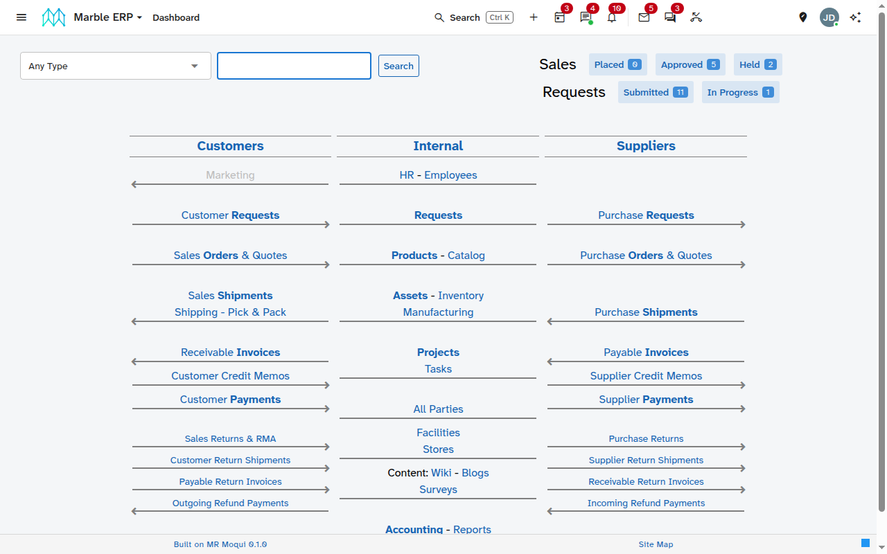

# MR Marble - Marble ERP and Simple Screens for MR Moqui

> **Not ready for production (before 0.1.0).** Like [MR Moqui](https://github.com/moqui/mr-moqui#readme), which it
> runs on, MR Marble is in early development. Its data model and stored data change without migrations, and a
> security review is under way with its findings recorded openly in the mr-moqui repository. Run it only on
> development machines, with no real business data or credentials, and not exposed to the internet. The full notice
> is at the top of the [mr-moqui README](https://github.com/moqui/mr-moqui#readme).

Marble ERP is the ERP application of Moqui, ported to [MR Moqui](https://github.com/moqui/mr-moqui), the Moqui
framework in Rust. It is a planning and management application for businesses that produce goods and services, and
sell to individuals (B2C) and organizations (B2B). This repository has it in one component, `mr-marble`, with the
library it is built from:

- **Marble ERP**: the application's shell and dashboard, at `/qapps/marble` (the browser client) and `/apps/marble`
  (plain HTML). Most of its screens are mounted from Simple Screens.
- **Simple Screens**: a library of screens and screen parts (forms, sections, transitions) to include, extend or
  reuse in applications on MR Moqui and [Mantle](https://github.com/moqui/mr-mantle), under `screen/SimpleScreens/`.
- **My Account**: a person's own messages, calendar, tasks, requests, time entries, expenses and account settings,
  at `/qapps/my`.

Marble ERP covers both goods and services, since goods businesses also manage projects and tasks, and services
businesses also manage equipment and supplies. It is designed around business activities in three categories by the
primary roles in the system: Internal, Supplier, and Customer. These activities fit into high level business
processes such as Procure to Pay (Supplier interactions) and Order to Cash (Customer interactions), and are combined
to support a complete end to end flow.



Marble is for those who use it on Moqui Java today and want the same application on MR Moqui. The suite designed for
MR Moqui is [IronStone BOSS](https://github.com/moqui/mr-boss); both run on the same Mantle data, side by side.

## State

A working port. Every screen is converted and runs, and the specs exercise the screens with data and the print
documents. It has not yet had a screen-by-screen review in the browser, or a review of authorization and of print
layout against the Java application; [MIGRATION-STATUS.md](MIGRATION-STATUS.md) records what is done and what is
open. Java FOP is not needed: the print documents are HTML, sent as PDF.

## Get it and try it

In an [mr-moqui](https://github.com/moqui/mr-moqui#quick-start) checkout:

```sh
./moq component-get mr-marble   # With mr-mantle, which it depends on
./moq load                      # Seed and demo data
./moq run
```

Open `http://localhost:8080`, sign in as `john.doe` with the password `moqui`, and choose Marble ERP in the app
list. The demo data is Mantle's: a company, Ziziwork Industries, with customers, suppliers, products and orders.

To have this component load before yours, depend on it in your `component.xml`:

```xml
<depends-on name="mr-marble"/>
```

## Developing

Read mr-moqui's [AGENTS.md](https://github.com/moqui/mr-moqui/blob/master/AGENTS.md) and
[application practices](https://github.com/moqui/mr-moqui/blob/master/docs/dev/Practices-App-Dev.md) first.

```sh
./moq test mr-mantle mr-marble     # The regression suite, while working
./moq test-apps                    # Every app component's regression suite, before a commit
./moq accept mr-mantle mr-marble   # The acceptance suite (the screen sweeps), when asked
```

The suites and their specs are in [test/README.md](test/README.md). `document/` has reference notes on order,
shipment, invoice and payment statuses, order roles and GL account classes.

## Coming from Moqui Java

This is the Java Moqui components [SimpleScreens](https://github.com/moqui/SimpleScreens) and
[MarbleERP](https://github.com/moqui/MarbleERP). The two were ported in forks (Groovy and FreeMarker to JavaScript,
XSL-FO to HTML print), then merged into this repository with the commit history of both. A component that depended
on either now depends on `mr-marble`, and its `component://SimpleScreens/` locations become
`component://mr-marble/`; the screen tree keeps its name, `screen/SimpleScreens/`. The renames are in mr-moqui's
[Moqui Java migration notes](https://github.com/moqui/mr-moqui/blob/master/docs/dev/Moqui-Java-Migration.md).
Questions are welcome on the [Moqui forum](https://forum.moqui.org).

## License and Contributing

[CC0 1.0 Universal with a Grant of Patent License](LICENSE.md). To contribute code, sign
[AUTHORS.md](AUTHORS.md) in a commit from the account that submits the pull request; its Contributing
section has the details.
